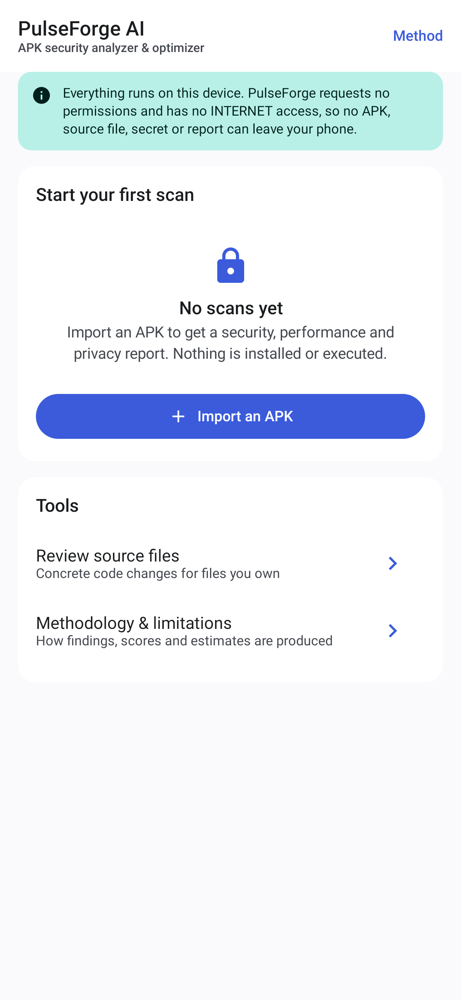
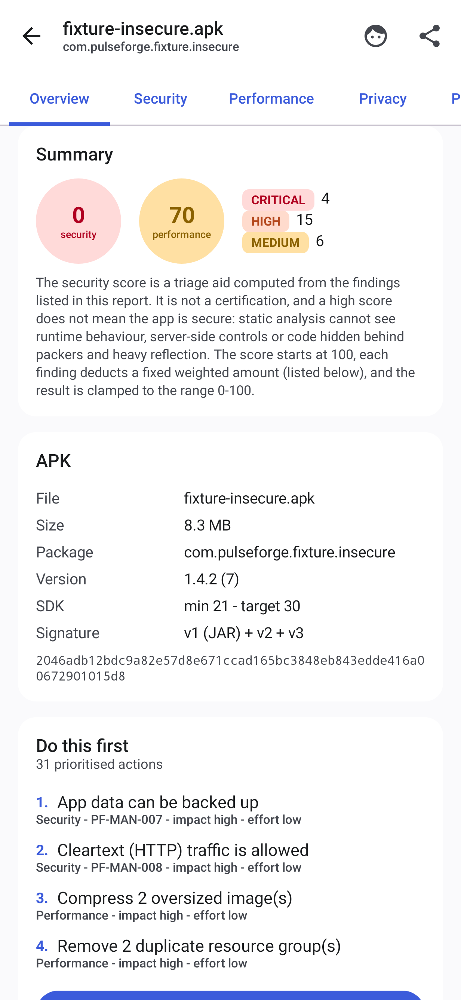
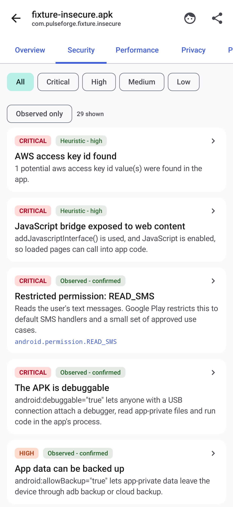
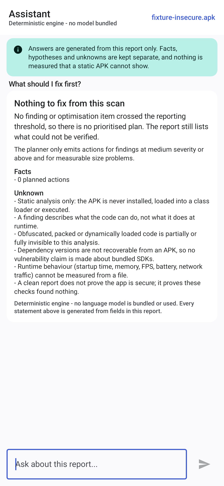
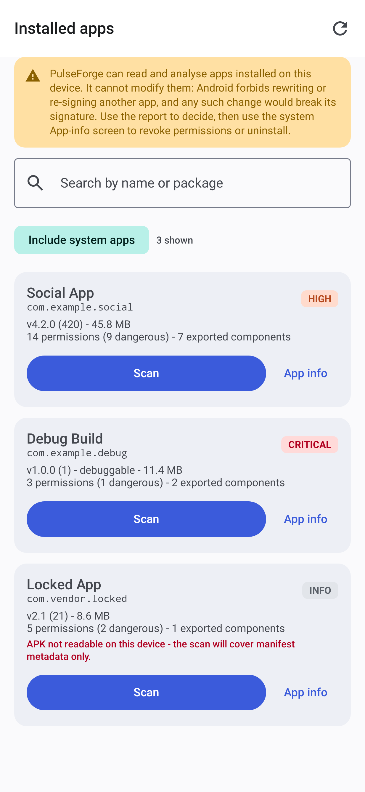
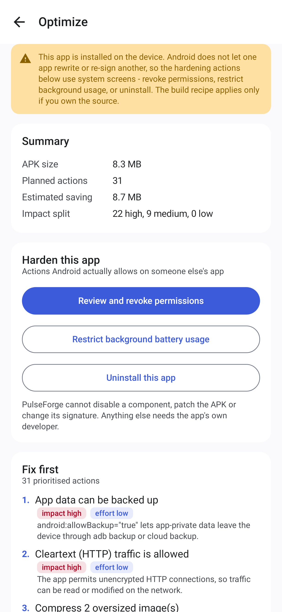
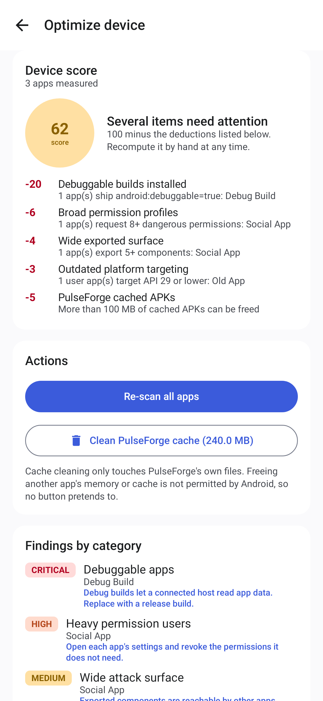
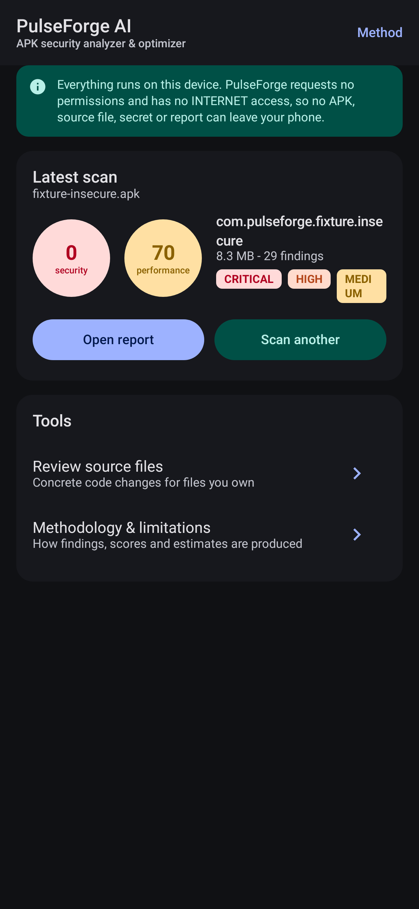

# PulseForge AI

**Universal APK security analyzer & optimizer for Android.**
Kotlin · Jetpack Compose · Material 3 · on-device static analysis · no network permission.

PulseForge reads an APK the way a build tool does — ZIP, compiled `AndroidManifest.xml`, DEX tables,
`resources.arsc`, the APK Signing Block — and reports what it can prove, what it can only infer, and
what a file simply cannot tell you. It never installs, loads or executes the APK it analyses.

---

## What it does

| Area | What PulseForge actually does |
|---|---|
| **APK import** | Storage Access Framework; the file is copied into app-private storage and analysed locally |
| **Installed apps** | Lists apps on the device (QUERY_ALL_PACKAGES), scans one through the same pipeline when its APK is readable, and falls back to a manifest-level report when the platform blocks the file |
| **Parsing** | Binary XML (AXML) manifest parser, DEX header/string/type/method/class tables, `resources.arsc` string pool, APK Signing Block (v2/v3/v3.1) + v1 JAR certs, image headers (PNG/JPEG/WebP/GIF/BMP) |
| **Security** | 26 rules mapped to OWASP MASVS and CWE, each with severity, confidence, evidence, remediation and a false-positive note |
| **Performance** | Size composition, SHA-256 duplicate detection, oversized-image detection, decoded-bitmap memory estimate, and an explicit list of metrics a static APK cannot provide |
| **Device view** | A device-wide score over every installed app (documented deductions), categories for debuggable apps, heavy permission users, wide exported surfaces, old targeting and reclaimable storage, plus a real cache clean for PulseForge's own files |
| **Optimization** | An Optimize screen per scan: prioritised actions, a paste-ready build recipe (R8, resource shrinking, ABI splits, WebP/asset pipeline, Baseline Profiles) conditioned on this report's own evidence, Markdown export, and system-level hardening actions when the app is installed |
| **Privacy** | Permission groups, dangerous/restricted permissions, exported-component count, tracker-class signals |
| **Reports** | PDF, JSON and Markdown export through SAF; before/after comparison of two scans |
| **Assistant** | Deterministic, evidence-grounded explainer that separates facts, hypotheses and unknowns. No model is bundled and none is pretended |
| **History** | Room database, per-scan delete, cached-APK cleanup, orphan sweep on startup |

## Screenshots

These are rendered from the real Compose screens by the UI test suite (Robolectric, native
graphics), using a report produced by the analyser on the synthetic `fixture-insecure.apk`. They are
regenerated on every CI run and published with the build.

| Dashboard (empty) | Report overview |
|---|---|
|  |  |

| Security findings | Assistant |
|---|---|
|  |  |

| Installed apps | Optimize |
|---|---|
|  |  |

| Optimize device |
|---|
|  |



## Download a build

Every push to `main` builds and publishes the APKs and the screenshots to the
[**ci-latest** release](https://github.com/technicalnihilist-lgtm/PulseForge-AI/releases/tag/ci-latest):

* `app-debug.apk` — debug build, debug key
* `app-release.apk` — minified release build (R8), debug key unless a release keystore is configured

Builds from CI are signed with the debug key, which is fine for installing and testing but is **not**
a production signature.

## Quick start

```bash
# 1. Toolchain: JDK 17, Android SDK 34, build-tools 34.0.0
export ANDROID_HOME=$HOME/Android/Sdk
export JAVA_HOME=/path/to/jdk-17

# 2. Synthetic fixtures + sample reports (uses aapt2, d8, apksigner from build-tools)
python3 tools/make-fixtures.py

# 3. Build and test
./gradlew :app:assembleDebug :app:testDebugUnitTest :core:apk:test :core:security:test

# 4. Install
adb install -r app/build/outputs/apk/debug/app-debug.apk
```

Full setup, release signing and reproducible-build notes: [`docs/BUILD.md`](docs/BUILD.md).

## What "optimize" means for each source

| Source | What PulseForge does | What it will not do |
|---|---|---|
| APK you built | Full static analysis, prioritised fixes, R8/baseline-profile/asset guidance, before/after comparison of two scans | Build the optimized APK for you — that is your build pipeline's job |
| APK from elsewhere | Full static analysis and a report-only optimization plan | Rebuild, patch or re-sign someone else's APK |
| App installed on the phone | Same analysis (installed APK when readable, else manifest metadata) plus an Optimize screen with the actions Android permits on someone else's app: review/revoke permissions, restrict background battery use, uninstall | Modify the installed app. Android forbids rewriting or re-signing it, and the change would break its signature |

## Honest limitations (read this)

* **Static only.** Findings describe what the code *can* do. Nothing here proves runtime behaviour.
* **No dependency versions.** An APK does not carry them, so PulseForge never claims an SDK is
  vulnerable — it names the SDK and tells you how to check.
* **No runtime numbers.** FPS, CPU, memory-in-use, battery and startup time are listed as
  *unavailable*, with the tool you would use to measure them. They are never invented.
* **Obfuscation and packers** hide code from any static analyser, including this one.
* **A clean report is not a security guarantee.** It means these checks found nothing.
* **Third-party APKs cannot be rebuilt.** PulseForge reports and recommends; it only proposes code
  changes for source files you supply yourself.

Details: [`docs/LIMITATIONS.md`](docs/LIMITATIONS.md), [`docs/THREAT-MODEL.md`](docs/THREAT-MODEL.md).

## Privacy by construction

* The app has **no INTERNET permission**, so it physically cannot upload an APK, source file,
  secret or report. It requests exactly one permission, `QUERY_ALL_PACKAGES`, which grants package
  metadata visibility so the "Installed apps" screen can list what is on the device — and removes
  the ones WorkManager would add.
* Secrets found in an APK are masked before they reach a report, and a final redaction pass
  (`ReportRedactor`) runs over every report as a safety net.
* APK copies live in private storage and are deleted with the scan; `backup_rules.xml` and
  `data_extraction_rules.xml` exclude them from backup and device transfer.

See [`docs/PRIVACY.md`](docs/PRIVACY.md).

## Architecture

Nine Gradle modules, each with one job:

```
:app                 Compose UI, navigation, WorkManager wiring, SAF export
:core:model          Serialisable domain model (no Android dependencies)
:core:apk            ZIP reader, AXML parser, DEX parser, ARSC pool, signing inspector
:core:security       Rule engine + 26 rules, permission catalogue, privacy analyser
:core:performance    Performance analysis, optimization planner, source review
:core:report         Scoring, redaction, pipeline, JSON/Markdown/PDF writers, diff
:core:data           Room history, FileVault, ScanWorker, settings (DataStore)
:core:ai             Deterministic offline assistant + local-model interface
:core:ui             Material 3 theme and shared components
```

`core:apk`, `core:security`, `core:performance`, `core:ai` and the scoring/writer parts of
`core:report` are plain JVM code, so the whole analysis pipeline is unit-tested on the JVM against
real APKs — no emulator required. See [`docs/ARCHITECTURE.md`](docs/ARCHITECTURE.md).

## Methodology

* [`docs/SECURITY-METHODOLOGY.md`](docs/SECURITY-METHODOLOGY.md) — how each rule works and what it can miss
* [`docs/PERFORMANCE-METHODOLOGY.md`](docs/PERFORMANCE-METHODOLOGY.md) — what is measured, estimated, or unavailable
* [`docs/SCORING.md`](docs/SCORING.md) — the exact score formula, so you can recompute it by hand

## Tests

| Suite | What it covers |
|---|---|
| `:core:apk:test` | AXML parser, manifest mapping, DEX tables, signing certs, duplicates, error handling — against real signed APKs |
| `:core:security:test` | Rule firing on an insecure fixture, non-firing on a hardened fixture, redaction, ordering |
| `:core:performance:test` | Measured vs estimated vs unavailable metrics, action generation, planner ordering, source review |
| `:core:report:test` | End-to-end pipeline, JSON round-trip, secret leakage guards, Markdown sections, diff |
| `:app:testDebugUnitTest` | Compose screens under Robolectric + screenshot capture |
| `:app:connectedDebugAndroidTest` | Device smoke test (needs an emulator/device) |

Fixtures are generated, not committed: `python3 tools/make-fixtures.py`.

## Licence

Apache 2.0 — see [`LICENSE`](LICENSE). Third-party library versions and licences are listed in
[`docs/BUILD.md`](docs/BUILD.md) and in the app's About screen.
