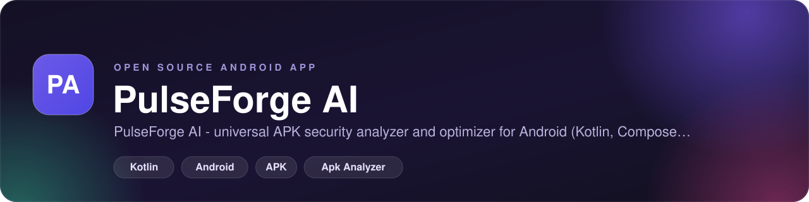
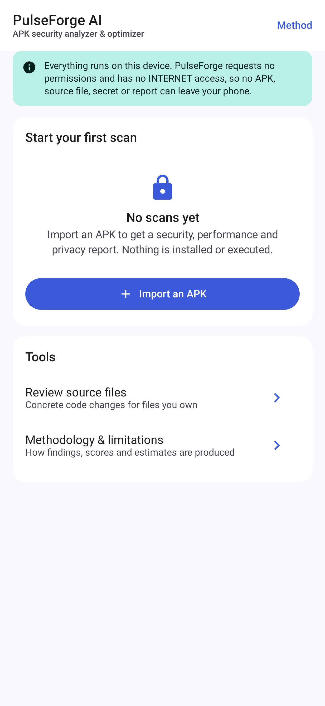
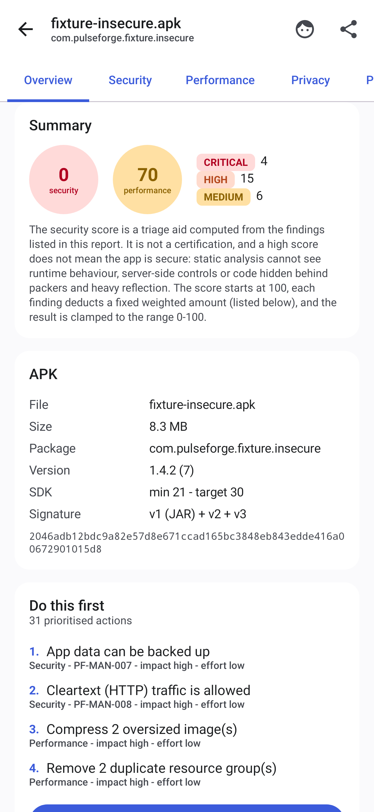
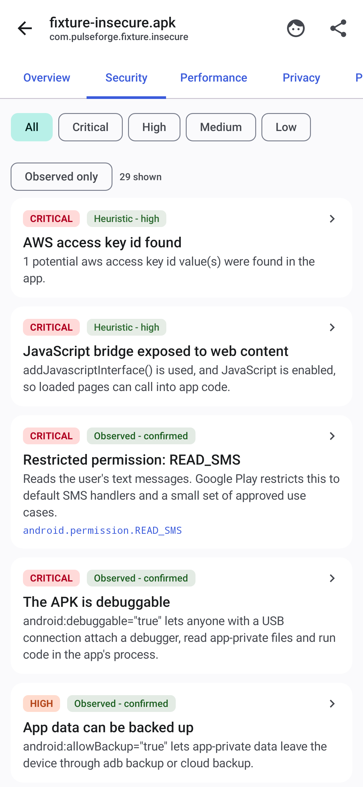
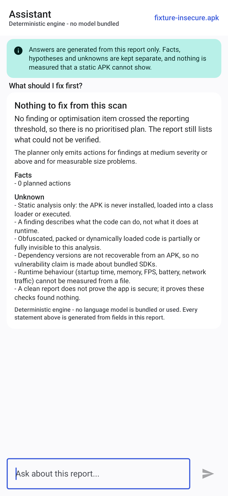
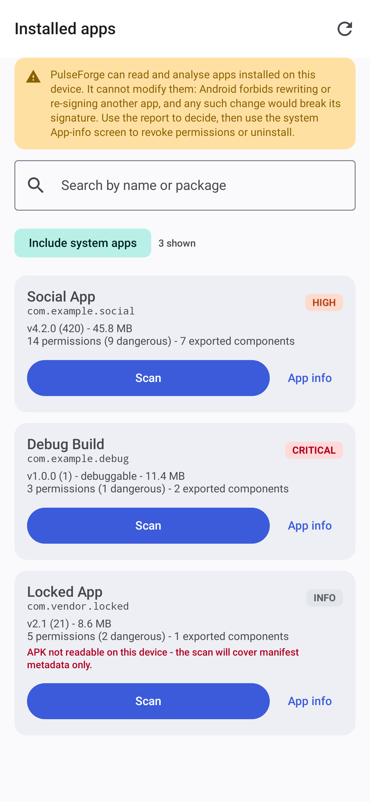
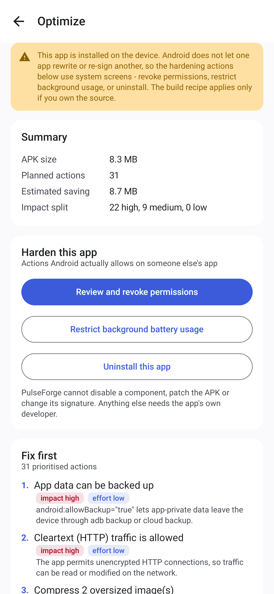
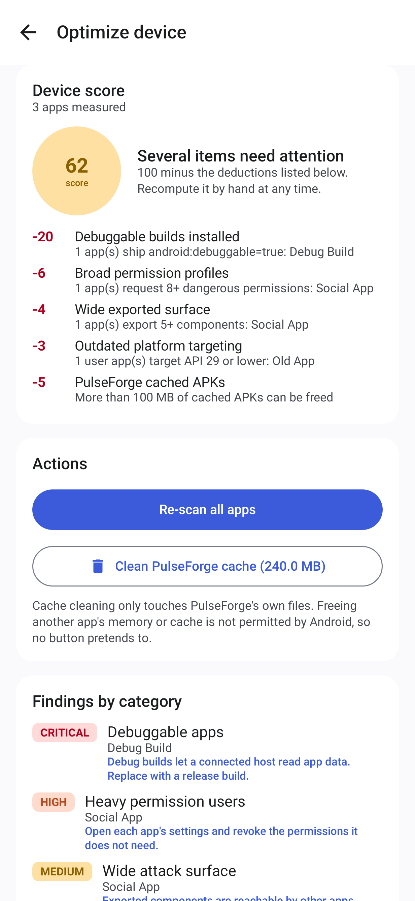
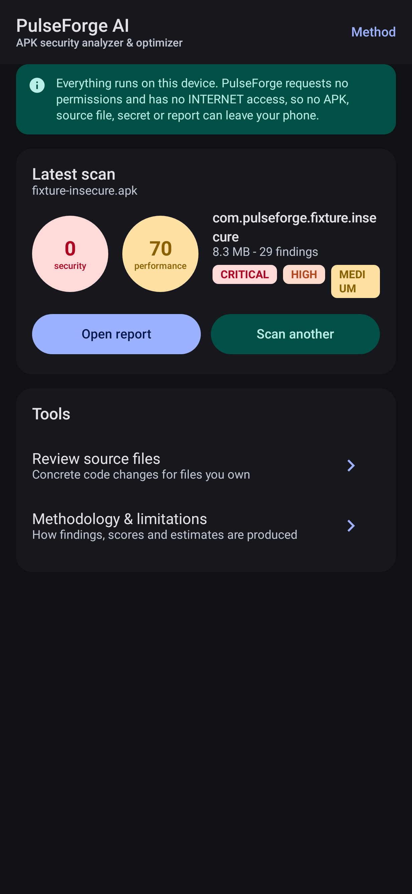

<div align="center">



<a href="https://github.com/technicalnihilist-lgtm/PulseForge-AI/stargazers"></a>&nbsp;<a href="https://github.com/technicalnihilist-lgtm/PulseForge-AI/network/members"></a>

<a href="https://github.com/technicalnihilist-lgtm/PulseForge-AI/releases/latest"></a>

<b>Support the work</b>

  

<sub>Donations aren't live yet — Paytm, UPI, PayPal and Buy&nbsp;Me&nbsp;a&nbsp;Coffee all show <b>coming soon</b>. Until then, a ⭐ star is the best support.</sub>

</div>

---

## What it does

| Area | What PulseForge actually does |
|---|---|
| **APK import** | Storage Access Framework; the file is copied into app-private storage and analysed locally |
| **Installed apps** | Lists apps on the device (QUERY_ALL_PACKAGES), scans one through the same pipeline when its APK is readable, and falls back to a manifest-level report when the platform blocks the file |
| **Parsing** | Binary XML (AXML) manifest parser, DEX header/string/type/method/class tables, `resources.arsc` string pool, APK Signing Block (v2/v3/v3.1) + v1 JAR certs, image headers (PNG/JPEG/WebP/GIF/BMP) |
| **Security** | 26 rules mapped to OWASP MASVS and CWE, each with severity, confidence, evidence, remediation and a false-positive note |
| **Performance** | Size composition, SHA-256 duplicate detection, oversized-image detection, decoded-bitmap memory estimate, and an explicit list of metrics a static APK cannot provide |
| **Device view** | A device-wide score over every installed app (documented deductions), categories for debuggable apps, heavy permission users, wide exported surfaces, old targeting and reclaimable storage, plus a real cache clean for PulseForge's own files |
| **Optimization** | An Optimize screen per scan: prioritised actions, a paste-ready build recipe (R8, resource shrinking, ABI splits, WebP/asset pipeline, Baseline Profiles) conditioned on this report's own evidence, Markdown export, and system-level hardening actions when the app is installed |
| **Privacy** | Permission groups, dangerous/restricted permissions, exported-component count, tracker-class signals |
| **Reports** | PDF, JSON and Markdown export through SAF; before/after comparison of two scans |
| **Assistant** | Deterministic, evidence-grounded explainer that separates facts, hypotheses and unknowns. No model is bundled and none is pretended |
| **History** | Room database, per-scan delete, cached-APK cleanup, orphan sweep on startup |

## Screenshots

These are rendered from the real Compose screens by the UI test suite (Robolectric, native
graphics), using a report produced by the analyser on the synthetic `fixture-insecure.apk`. They are
regenerated on every CI run and published with the build.

| Dashboard (empty) | Report overview |
|---|---|
|  |  |

| Security findings | Assistant |
|---|---|
|  |  |

| Installed apps | Optimize |
|---|---|
|  |  |

| Optimize device |
|---|
|  |



## Download a build

Every push to `main` builds and publishes the APKs and the screenshots to the
[**ci-latest** release](https://github.com/technicalnihilist-lgtm/PulseForge-AI/releases/tag/ci-latest):

* `app-debug.apk` — debug build, debug key
* `app-release.apk` — minified release build (R8), debug key unless a release keystore is configured

Builds from CI are signed with the debug key, which is fine for installing and testing but is **not**
a production signature.

## What "optimize" means for each source

| Source | What PulseForge does | What it will not do |
|---|---|---|
| APK you built | Full static analysis, prioritised fixes, R8/baseline-profile/asset guidance, before/after comparison of two scans | Build the optimized APK for you — that is your build pipeline's job |
| APK from elsewhere | Full static analysis and a report-only optimization plan | Rebuild, patch or re-sign someone else's APK |
| App installed on the phone | Same analysis (installed APK when readable, else manifest metadata) plus an Optimize screen with the actions Android permits on someone else's app: review/revoke permissions, restrict background battery use, uninstall | Modify the installed app. Android forbids rewriting or re-signing it, and the change would break its signature |

## Honest limitations (read this)

* **Static only.** Findings describe what the code *can* do. Nothing here proves runtime behaviour.
* **No dependency versions.** An APK does not carry them, so PulseForge never claims an SDK is
  vulnerable — it names the SDK and tells you how to check.
* **No runtime numbers.** FPS, CPU, memory-in-use, battery and startup time are listed as
  *unavailable*, with the tool you would use to measure them. They are never invented.
* **Obfuscation and packers** hide code from any static analyser, including this one.
* **A clean report is not a security guarantee.** It means these checks found nothing.
* **Third-party APKs cannot be rebuilt.** PulseForge reports and recommends; it only proposes code
  changes for source files you supply yourself.

Details: [`docs/LIMITATIONS.md`](docs/LIMITATIONS.md), [`docs/THREAT-MODEL.md`](docs/THREAT-MODEL.md).

## Privacy by construction

* The app has **no INTERNET permission**, so it physically cannot upload an APK, source file,
  secret or report. It requests exactly one permission, `QUERY_ALL_PACKAGES`, which grants package
  metadata visibility so the "Installed apps" screen can list what is on the device — and removes
  the ones WorkManager would add.
* Secrets found in an APK are masked before they reach a report, and a final redaction pass
  (`ReportRedactor`) runs over every report as a safety net.
* APK copies live in private storage and are deleted with the scan; `backup_rules.xml` and
  `data_extraction_rules.xml` exclude them from backup and device transfer.

See [`docs/PRIVACY.md`](docs/PRIVACY.md).

## Architecture

Nine Gradle modules, each with one job:

```
:app                 Compose UI, navigation, WorkManager wiring, SAF export
:core:model          Serialisable domain model (no Android dependencies)
:core:apk            ZIP reader, AXML parser, DEX parser, ARSC pool, signing inspector
:core:security       Rule engine + 26 rules, permission catalogue, privacy analyser
:core:performance    Performance analysis, optimization planner, source review
:core:report         Scoring, redaction, pipeline, JSON/Markdown/PDF writers, diff
:core:data           Room history, FileVault, ScanWorker, settings (DataStore)
:core:ai             Deterministic offline assistant + local-model interface
:core:ui             Material 3 theme and shared components
```

`core:apk`, `core:security`, `core:performance`, `core:ai` and the scoring/writer parts of
`core:report` are plain JVM code, so the whole analysis pipeline is unit-tested on the JVM against
real APKs — no emulator required. See [`docs/ARCHITECTURE.md`](docs/ARCHITECTURE.md).

## Methodology

* [`docs/SECURITY-METHODOLOGY.md`](docs/SECURITY-METHODOLOGY.md) — how each rule works and what it can miss
* [`docs/PERFORMANCE-METHODOLOGY.md`](docs/PERFORMANCE-METHODOLOGY.md) — what is measured, estimated, or unavailable
* [`docs/SCORING.md`](docs/SCORING.md) — the exact score formula, so you can recompute it by hand

## Tests

| Suite | What it covers |
|---|---|
| `:core:apk:test` | AXML parser, manifest mapping, DEX tables, signing certs, duplicates, error handling — against real signed APKs |
| `:core:security:test` | Rule firing on an insecure fixture, non-firing on a hardened fixture, redaction, ordering |
| `:core:performance:test` | Measured vs estimated vs unavailable metrics, action generation, planner ordering, source review |
| `:core:report:test` | End-to-end pipeline, JSON round-trip, secret leakage guards, Markdown sections, diff |
| `:app:testDebugUnitTest` | Compose screens under Robolectric + screenshot capture |
| `:app:connectedDebugAndroidTest` | Device smoke test (needs an emulator/device) |

Fixtures are generated, not committed: `python3 tools/make-fixtures.py`.

## Licence

MIT — see [`LICENSE`](LICENSE). Third-party library versions and licences are listed in
[`docs/BUILD.md`](docs/BUILD.md) and in the app's About screen.

---

---

## 🌍 Languages

<sub>Donations are <b>coming soon</b> in every language below — nothing to pay today, nothing to click.</sub>

<div align="center">

<sub><b>हिन्दी · বাংলা · मराठी · తెలుగు · தமிழ் · ગુજરાતી · ಕನ್ನಡ · മലയാളം · ਪੰਜਾਬੀ · ଓଡ଼ିଆ · অসমীয়া · اردو</b></sub>

</div>

<details>
<summary><b>🌍 Open the same message in 53 languages</b></summary>

**🇮🇳 Indian languages**

- **हिन्दी** (Hindi) — ☕ जल्द ही आ रहा है। · ⭐ अगर आपको यह ऐप और हमारा काम पसंद है, तो कृपया रिपॉजिटरी को स्टार दें और हमें फॉलो करें।
- **বাংলা** (Bengali) — ☕ খুব শিগগিরই আসছে। · ⭐ যদি আপনার এই অ্যাপ এবং আমাদের কাজ ভালো লাগে, তবে অনুগ্রহ করে রিপোজিটরিটিকে একটি স্টার দিন এবং আমাদের ফলো করুন।
- **मराठी** (Marathi) — ☕ लवकरच येत आहे. · ⭐ जर तुम्हाला हे ॲप आणि आमचं काम आवडलं असेल, तर कृपया रिपॉझिटरीला स्टार द्या आणि आम्हाला फॉलो करा.
- **తెలుగు** (Telugu) — ☕ త్వరలో రాబోతోంది. · ⭐ మీకు ఈ యాప్, మా పని నచ్చితే, దయచేసి రిపోజిటరీకి ఒక స్టార్ ఇచ్చి మమ్మల్ని ఫాలో అవ్వండి.
- **தமிழ்** (Tamil) — ☕ விரைவில் வருகிறது. · ⭐ உங்களுக்கு இந்த ஆப்பும் எங்க வேலையும் பிடிச்சிருந்தா, தயவுசெஞ்சு இந்த ரெபாசிட்டரிக்கு ஒரு ஸ்டார்…
- **ગુજરાતી** (Gujarati) — ☕ ટૂંક સમયમાં આવી રહ્યું છે. · ⭐ જો તમને આ એપ અને અમારું કામ ગમતું હોય, તો પ્લીઝ રિપોઝિટરીને સ્ટાર આપો અને અમને ફોલો કરો.
- **ಕನ್ನಡ** (Kannada) — ☕ ಶೀಘ್ರದಲ್ಲೇ ಬರುತ್ತಿದೆ. · ⭐ ನಿಮಗೆ ಈ ಆ್ಯಪ್ ಮತ್ತು ನಮ್ಮ ಕೆಲಸ ಇಷ್ಟವಾದರೆ, ದಯವಿಟ್ಟು ರೆಪೊಸಿಟರಿಗೆ ಸ್ಟಾರ್ ಕೊಡಿ ಮತ್ತು ನಮ್ಮನ್ನು ಫಾಲೋ ಮಾಡಿ.
- **മലയാളം** (Malayalam) — ☕ ഉടൻ വരുന്നു. · ⭐ നിങ്ങൾക്ക് ഈ ആപ്പും ഞങ്ങളുടെ പ്രവർത്തനവും ഇഷ്ടപ്പെട്ടെങ്കിൽ, ദയവായി റെപ്പോസിറ്ററിക്ക് ഒരു സ്റ്റാർ…
- **ਪੰਜਾਬੀ** (Punjabi) — ☕ ਜਲਦੀ ਆ ਰਿਹਾ ਹੈ। · ⭐ ਜੇ ਤੁਹਾਨੂੰ ਇਹ ਐਪ ਅਤੇ ਸਾਡਾ ਕੰਮ ਪਸੰਦ ਹੈ, ਤਾਂ ਕਿਰਪਾ ਕਰਕੇ ਰਿਪੋਜ਼ਟਰੀ ਨੂੰ ਸਟਾਰ ਦਿਓ ਅਤੇ ਸਾਨੂੰ ਫਾਲੋ ਕਰੋ।
- **ଓଡ଼ିଆ** (Odia) — ☕ ଖୁବ୍ ଶୀଘ୍ର ଆସୁଛି। · ⭐ ଯଦି ଆପଣଙ୍କୁ ଏହି ଆପ୍ ଏବଂ ଆମର କାମ ଭଲ ଲାଗୁଛି, ତେବେ ଦୟାକରି ରିପୋଜିଟୋରୀକୁ ଗୋଟିଏ ଷ୍ଟାର୍ ଦିଅନ୍ତୁ ଏବଂ ଆମକୁ ଫଲୋ କରନ୍ତୁ।
- **অসমীয়া** (Assamese) — ☕ অতি সোনকালেই আহি আছে। · ⭐ যদি আপুনি এই এপটো আৰু আমাৰ কাম ভাল পায়, তেন্তে অনুগ্ৰহ কৰি ৰিপজিটৰীটোক এটা ষ্টাৰ দিয়ক আৰু আমাক ফ'ল' কৰক।
- **اردو** (Urdu) — ☕ جلد آرہا ہے۔ · ⭐ اگر آپ کو یہ ایپ اور ہمارا کام پسند آئے تو براہ کرم ریپازٹری کو سٹار دیں اور ہمیں فالو کریں۔
- **संस्कृतम्** (Sanskrit) — ☕ शीघ्रमेव आगच्छति।
- **मैथिली** (Maithili) — ☕ जल्दिये आबि रहल अछि।
- **कोंकणी** (Konkani) — ☕ रोखडेंच येता.
- **کٲشُر** (Kashmiri) — ☕ جَلدی یِوان چھُ۔
- **سنڌي** (Sindhi) — ☕ जल्द अची रह्यो आहे।
- **डोगरी** (Dogri) — ☕ जल्दी आ करदा ऐ।
- **ꯃꯤꯇꯩ ꯂꯣꯟ** (Manipuri) — ☕ ꯑꯊꯨꯕꯥ ꯃꯇꯝꯗꯥ ꯂꯥꯛꯀꯅꯤ꯫
- **बर’** (Bodo) — ☕ थाबैनो फैगोन।
- **ᱥᱟᱱᱛᱟᱲᱤ** (Santali) — ☕ ᱞᱚᱜᱚᱱ ᱦᱤᱡᱩᱜ ᱠᱟᱱᱟ᱾
- **नेपाली** (Nepali) — ☕ छिट्टै आउँदैछ। · ⭐ यदि तपाईंलाई यो एप र हाम्रो काम मन पर्‍यो भने, कृपया रिपोजिटरीलाई स्टार दिनुहोस् र हामीलाई फलो गर्नुहोस्।

**🌍 World languages**

- **العربية** (Arabic) — ☕ قريبًا. · ⭐ إذا أعجبك هذا التطبيق وعملنا، فيرجى منح المستودع نجمة ومتابعتنا.
- **简体中文** (Chinese (Simplified)) — ☕ 即将推出。
- **繁體中文** (Chinese (Traditional)) — ☕ 即將推出。
- **Čeština** (Czech) — ☕ Již brzy.
- **Dansk** (Danish) — ☕ Kommer snart.
- **Nederlands** (Dutch) — ☕ Binnenkort beschikbaar. · ⭐ Vind je deze app en ons werk leuk?
- **Filipino** (Filipino) — ☕ Malapit na.
- **Suomi** (Finnish) — ☕ Tulossa pian.
- **Français** (French) — ☕ Bientôt disponible. · ⭐ Si cette application et notre travail vous plaisent, mettez une étoile au dépôt et suivez-nous.
- **Deutsch** (German) — ☕ Bald verfügbar. · ⭐ Wenn dir diese App und unsere Arbeit gefallen, gib dem Repository einen Stern und folge uns.
- **Ελληνικά** (Greek) — ☕ Έρχεται σύντομα.
- **עברית** (Hebrew) — ☕ בקרוב.
- **Magyar** (Hungarian) — ☕ Hamarosan.
- **Bahasa Indonesia** (Indonesian) — ☕ Segera hadir. · ⭐ Jika kamu suka aplikasi ini dan karya kami, beri bintang pada repositori ini dan ikuti kami.
- **Italiano** (Italian) — ☕ In arrivo.
- **日本語** (Japanese) — ☕ 近日公開。 · ⭐ このアプリと私たちの仕事が気に入ったら、リポジトリにスターを付けてフォローしてください。
- **한국어** (Korean) — ☕ 곧 공개됩니다. · ⭐ 이 앱과 저희 작업이 마음에 드신다면 저장소에 스타를 눌러 주시고 팔로우해 주세요.
- **Bahasa Melayu** (Malay) — ☕ Akan datang.
- **Norsk** (Norwegian) — ☕ Kommer snart.
- **فارسی** (Persian) — ☕ به‌زودی.
- **Polski** (Polish) — ☕ Wkrótce. · ⭐ Jeśli podoba Ci się ta aplikacja i nasza praca, daj repozytorium gwiazdkę i obserwuj nas.
- **Português** (Portuguese) — ☕ Em breve.
- **Română** (Romanian) — ☕ În curând.
- **Русский** (Russian) — ☕ Скоро. · ⭐ Если вам нравится это приложение и наша работа, поставьте звёздочку репозиторию и подпишитесь на нас.
- **Español** (Spanish) — ☕ Muy pronto. · ⭐ Si te gusta esta app y nuestro trabajo, dale una estrella al repositorio y síguenos.
- **Kiswahili** (Swahili) — ☕ Inakuja hivi karibuni.
- **Svenska** (Swedish) — ☕ Kommer snart.
- **ไทย** (Thai) — ☕ เร็ว ๆ นี้
- **Türkçe** (Turkish) — ☕ Çok yakında.
- **Українська** (Ukrainian) — ☕ Незабаром.
- **Tiếng Việt** (Vietnamese) — ☕ Sắp ra mắt. · ⭐ Nếu bạn thích ứng dụng này và công việc của chúng tôi, hãy tặng kho lưu trữ một ngôi sao và theo…

</details>

