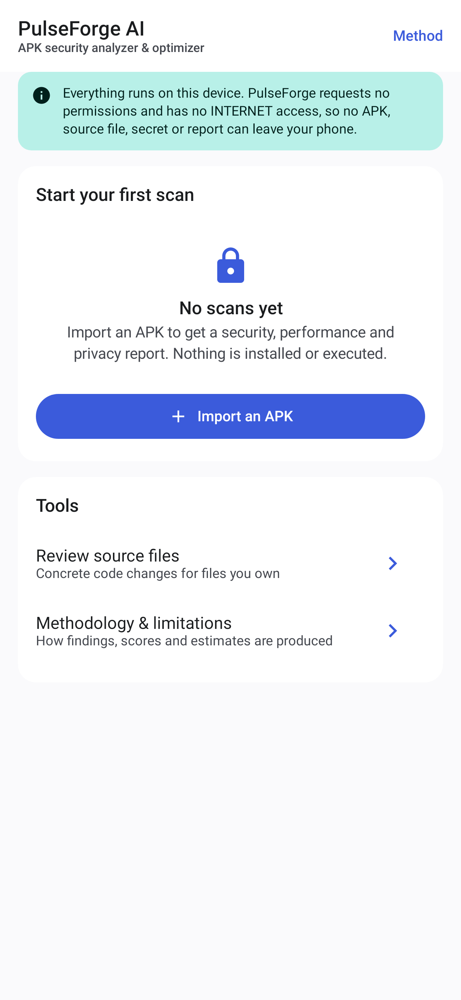
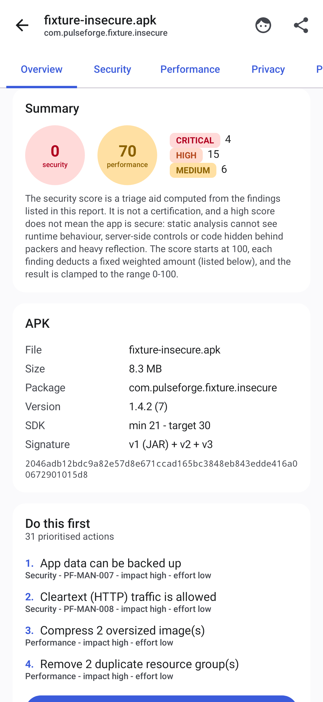
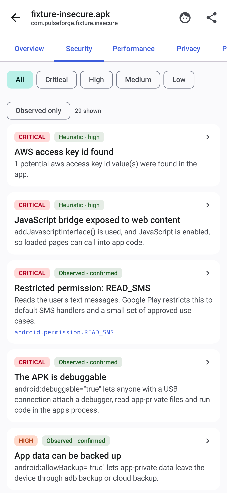
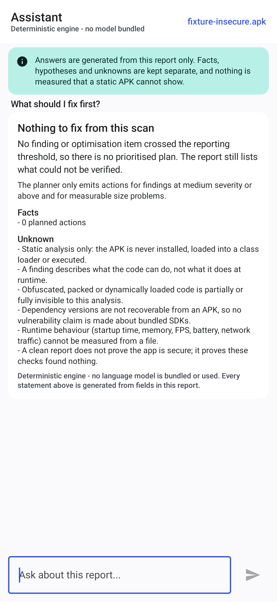
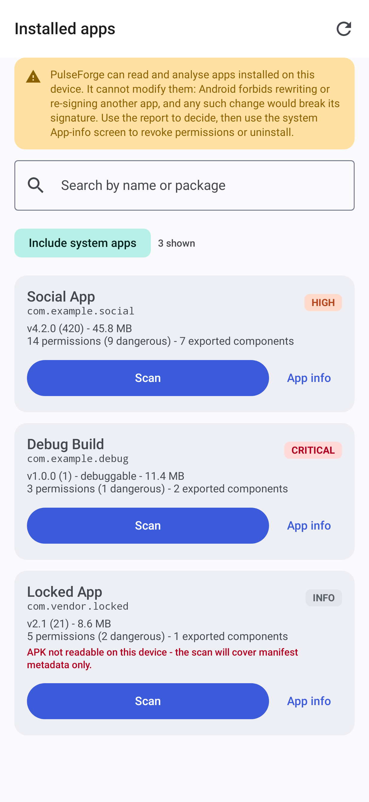
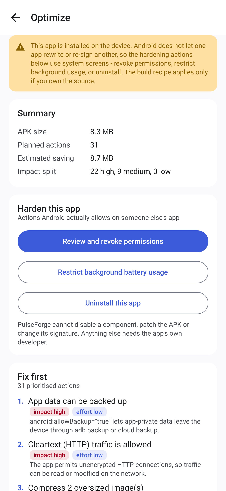
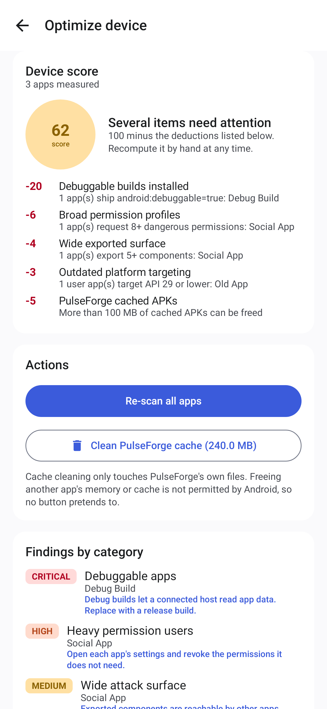
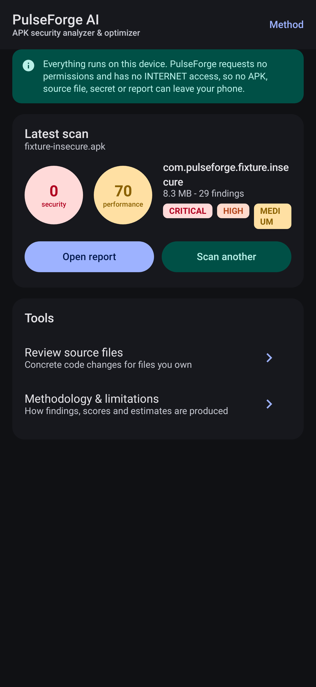

# PulseForge AI

**Universal APK security analyzer & optimizer for Android.**
Kotlin · Jetpack Compose · Material 3 · on-device static analysis · no network permission.

PulseForge reads an APK the way a build tool does — ZIP, compiled `AndroidManifest.xml`, DEX tables,
`resources.arsc`, the APK Signing Block — and reports what it can prove, what it can only infer, and
what a file simply cannot tell you. It never installs, loads or executes the APK it analyses.

---

## What it does

| Area | What PulseForge actually does |
|---|---|
| **APK import** | Storage Access Framework; the file is copied into app-private storage and analysed locally |
| **Installed apps** | Lists apps on the device (QUERY_ALL_PACKAGES), scans one through the same pipeline when its APK is readable, and falls back to a manifest-level report when the platform blocks the file |
| **Parsing** | Binary XML (AXML) manifest parser, DEX header/string/type/method/class tables, `resources.arsc` string pool, APK Signing Block (v2/v3/v3.1) + v1 JAR certs, image headers (PNG/JPEG/WebP/GIF/BMP) |
| **Security** | 26 rules mapped to OWASP MASVS and CWE, each with severity, confidence, evidence, remediation and a false-positive note |
| **Performance** | Size composition, SHA-256 duplicate detection, oversized-image detection, decoded-bitmap memory estimate, and an explicit list of metrics a static APK cannot provide |
| **Device view** | A device-wide score over every installed app (documented deductions), categories for debuggable apps, heavy permission users, wide exported surfaces, old targeting and reclaimable storage, plus a real cache clean for PulseForge's own files |
| **Optimization** | An Optimize screen per scan: prioritised actions, a paste-ready build recipe (R8, resource shrinking, ABI splits, WebP/asset pipeline, Baseline Profiles) conditioned on this report's own evidence, Markdown export, and system-level hardening actions when the app is installed |
| **Privacy** | Permission groups, dangerous/restricted permissions, exported-component count, tracker-class signals |
| **Reports** | PDF, JSON and Markdown export through SAF; before/after comparison of two scans |
| **Assistant** | Deterministic, evidence-grounded explainer that separates facts, hypotheses and unknowns. No model is bundled and none is pretended |
| **History** | Room database, per-scan delete, cached-APK cleanup, orphan sweep on startup |

## Screenshots

These are rendered from the real Compose screens by the UI test suite (Robolectric, native
graphics), using a report produced by the analyser on the synthetic `fixture-insecure.apk`. They are
regenerated on every CI run and published with the build.

| Dashboard (empty) | Report overview |
|---|---|
|  |  |

| Security findings | Assistant |
|---|---|
|  |  |

| Installed apps | Optimize |
|---|---|
|  |  |

| Optimize device |
|---|
|  |



## Download a build

Every push to `main` builds and publishes the APKs and the screenshots to the
[**ci-latest** release](https://github.com/technicalnihilist-lgtm/PulseForge-AI/releases/tag/ci-latest):

* `app-debug.apk` — debug build, debug key
* `app-release.apk` — minified release build (R8), debug key unless a release keystore is configured

Builds from CI are signed with the debug key, which is fine for installing and testing but is **not**
a production signature.

## Quick start

```bash
# 1. Toolchain: JDK 17, Android SDK 34, build-tools 34.0.0
export ANDROID_HOME=$HOME/Android/Sdk
export JAVA_HOME=/path/to/jdk-17

# 2. Synthetic fixtures + sample reports (uses aapt2, d8, apksigner from build-tools)
python3 tools/make-fixtures.py

# 3. Build and test
./gradlew :app:assembleDebug :app:testDebugUnitTest :core:apk:test :core:security:test

# 4. Install
adb install -r app/build/outputs/apk/debug/app-debug.apk
```

Full setup, release signing and reproducible-build notes: [`docs/BUILD.md`](docs/BUILD.md).

## What "optimize" means for each source

| Source | What PulseForge does | What it will not do |
|---|---|---|
| APK you built | Full static analysis, prioritised fixes, R8/baseline-profile/asset guidance, before/after comparison of two scans | Build the optimized APK for you — that is your build pipeline's job |
| APK from elsewhere | Full static analysis and a report-only optimization plan | Rebuild, patch or re-sign someone else's APK |
| App installed on the phone | Same analysis (installed APK when readable, else manifest metadata) plus an Optimize screen with the actions Android permits on someone else's app: review/revoke permissions, restrict background battery use, uninstall | Modify the installed app. Android forbids rewriting or re-signing it, and the change would break its signature |

## Honest limitations (read this)

* **Static only.** Findings describe what the code *can* do. Nothing here proves runtime behaviour.
* **No dependency versions.** An APK does not carry them, so PulseForge never claims an SDK is
  vulnerable — it names the SDK and tells you how to check.
* **No runtime numbers.** FPS, CPU, memory-in-use, battery and startup time are listed as
  *unavailable*, with the tool you would use to measure them. They are never invented.
* **Obfuscation and packers** hide code from any static analyser, including this one.
* **A clean report is not a security guarantee.** It means these checks found nothing.
* **Third-party APKs cannot be rebuilt.** PulseForge reports and recommends; it only proposes code
  changes for source files you supply yourself.

Details: [`docs/LIMITATIONS.md`](docs/LIMITATIONS.md), [`docs/THREAT-MODEL.md`](docs/THREAT-MODEL.md).

## Privacy by construction

* The app has **no INTERNET permission**, so it physically cannot upload an APK, source file,
  secret or report. It requests exactly one permission, `QUERY_ALL_PACKAGES`, which grants package
  metadata visibility so the "Installed apps" screen can list what is on the device — and removes
  the ones WorkManager would add.
* Secrets found in an APK are masked before they reach a report, and a final redaction pass
  (`ReportRedactor`) runs over every report as a safety net.
* APK copies live in private storage and are deleted with the scan; `backup_rules.xml` and
  `data_extraction_rules.xml` exclude them from backup and device transfer.

See [`docs/PRIVACY.md`](docs/PRIVACY.md).

## Architecture

Nine Gradle modules, each with one job:

```
:app                 Compose UI, navigation, WorkManager wiring, SAF export
:core:model          Serialisable domain model (no Android dependencies)
:core:apk            ZIP reader, AXML parser, DEX parser, ARSC pool, signing inspector
:core:security       Rule engine + 26 rules, permission catalogue, privacy analyser
:core:performance    Performance analysis, optimization planner, source review
:core:report         Scoring, redaction, pipeline, JSON/Markdown/PDF writers, diff
:core:data           Room history, FileVault, ScanWorker, settings (DataStore)
:core:ai             Deterministic offline assistant + local-model interface
:core:ui             Material 3 theme and shared components
```

`core:apk`, `core:security`, `core:performance`, `core:ai` and the scoring/writer parts of
`core:report` are plain JVM code, so the whole analysis pipeline is unit-tested on the JVM against
real APKs — no emulator required. See [`docs/ARCHITECTURE.md`](docs/ARCHITECTURE.md).

## Methodology

* [`docs/SECURITY-METHODOLOGY.md`](docs/SECURITY-METHODOLOGY.md) — how each rule works and what it can miss
* [`docs/PERFORMANCE-METHODOLOGY.md`](docs/PERFORMANCE-METHODOLOGY.md) — what is measured, estimated, or unavailable
* [`docs/SCORING.md`](docs/SCORING.md) — the exact score formula, so you can recompute it by hand

## Tests

| Suite | What it covers |
|---|---|
| `:core:apk:test` | AXML parser, manifest mapping, DEX tables, signing certs, duplicates, error handling — against real signed APKs |
| `:core:security:test` | Rule firing on an insecure fixture, non-firing on a hardened fixture, redaction, ordering |
| `:core:performance:test` | Measured vs estimated vs unavailable metrics, action generation, planner ordering, source review |
| `:core:report:test` | End-to-end pipeline, JSON round-trip, secret leakage guards, Markdown sections, diff |
| `:app:testDebugUnitTest` | Compose screens under Robolectric + screenshot capture |
| `:app:connectedDebugAndroidTest` | Device smoke test (needs an emulator/device) |

Fixtures are generated, not committed: `python3 tools/make-fixtures.py`.

## Licence

MIT — see [`LICENSE`](LICENSE). Third-party library versions and licences are listed in
[`docs/BUILD.md`](docs/BUILD.md) and in the app's About screen.

---

## ⭐ Like this work? Give it a star

If you like this app and our work, please **star this repository** ⭐ and **[follow technicalnihilist-lgtm on GitHub](https://github.com/technicalnihilist-lgtm)**. If our work isn't for you, that's completely fine — the choice is yours. Thank you for stopping by!

<details>
<summary><b>🌍 Same message in 32 languages (A–Z + Indian languages)</b></summary>

- **A — Arabic** (العربية): ⭐ إذا أعجبك هذا التطبيق وعملنا، فيرجى منح المستودع نجمة ومتابعتنا. وإذا لم يعجبك عملنا، فلا مشكلة على الإطلاق — القرار قرارك. شكرًا لزيارتك!
- **B — Bengali** (বাংলা): ⭐ যদি আপনার এই অ্যাপ এবং আমাদের কাজ ভালো লাগে, তবে অনুগ্রহ করে রিপোজিটরিটিকে একটি স্টার দিন এবং আমাদের ফলো করুন। আমাদের কাজ যদি আপনার পছন্দ না হয়, তাতেও কোনো সমস্যা নেই — সিদ্ধান্ত আপনার। আমাদের পেজে আসার জন্য ধন্যবাদ!
- **C — Chinese** (中文): ⭐ 如果你喜欢这个应用和我们的作品，请给仓库点个星标并关注我们。如果我们的作品不适合你，也完全没关系——选择权在你。感谢你的到访！
- **D — Dutch** (Nederlands): ⭐ Vind je deze app en ons werk leuk? Geef de repository dan een ster en volg ons. Vind je ons werk niets, dan is dat helemaal prima — de keuze is aan jou. Bedankt voor je bezoek!
- **E — English** (English): ⭐ If you like this app and our work, please give the repository a star and follow us. If our work isn't for you, that's completely fine — the choice is yours. Thank you for stopping by!
- **F — French** (Français): ⭐ Si cette application et notre travail vous plaisent, mettez une étoile au dépôt et suivez-nous. Si notre travail n'est pas pour vous, aucun souci — c'est votre choix. Merci de votre visite !
- **G — German** (Deutsch): ⭐ Wenn dir diese App und unsere Arbeit gefallen, gib dem Repository einen Stern und folge uns. Wenn unsere Arbeit nichts für dich ist, ist das völlig in Ordnung — die Wahl liegt bei dir. Danke fürs Vorbeischauen!
- **H — Hindi** (हिन्दी): ⭐ अगर आपको यह ऐप और हमारा काम पसंद है, तो कृपया रिपॉजिटरी को स्टार दें और हमें फॉलो करें। अगर हमारा काम आपके लिए नहीं है, तो भी कोई बात नहीं — यह पूरी तरह आपकी मर्ज़ी है। यहाँ आने के लिए आपका धन्यवाद!
- **I — Indonesian** (Bahasa Indonesia): ⭐ Jika kamu suka aplikasi ini dan karya kami, beri bintang pada repositori ini dan ikuti kami. Kalau karya kami bukan untukmu, tidak masalah sama sekali — itu pilihanmu. Terima kasih sudah mampir!
- **J — Japanese** (日本語): ⭐ このアプリと私たちの仕事が気に入ったら、リポジトリにスターを付けてフォローしてください。合わない場合はまったく問題ありません — 選ぶのはあなたです。お越しいただきありがとうございます！
- **K — Korean** (한국어): ⭐ 이 앱과 저희 작업이 마음에 드신다면 저장소에 스타를 눌러 주시고 팔로우해 주세요. 저희 작업이 맞지 않으셔도 전혀 괜찮습니다 — 선택은 여러분의 몫입니다. 방문해 주셔서 감사합니다!
- **L — Lithuanian** (Lietuvių): ⭐ Jei tau patinka ši programa ir mūsų darbas, duok saugyklai žvaigždutę ir sek mus. Jei mūsų darbas ne tau, viskas gerai — pasirinkimas tavo. Ačiū, kad užsukai!
- **M — Malayalam** (മലയാളം): ⭐ നിങ്ങൾക്ക് ഈ ആപ്പും ഞങ്ങളുടെ പ്രവർത്തനവും ഇഷ്ടപ്പെട്ടെങ്കിൽ, ദയവായി റെപ്പോസിറ്ററിക്ക് ഒരു സ്റ്റാർ നൽകുകയും ഞങ്ങളെ ഫോളോ ചെയ്യുകയും ചെയ്യുക. ഞങ്ങളുടെ പ്രവർത്തനം നിങ്ങൾക്ക് അനുയോജ്യമല്ലെങ്കിൽ, അതും തികച്ചും കുഴപ്പമില്ല — തീരുമാനം നിങ്ങളുടേതാണ്. ഇവിടെ വന്നതിന് നന്ദി!
- **N — Nepali** (नेपाली): ⭐ यदि तपाईंलाई यो एप र हाम्रो काम मन पर्‍यो भने, कृपया रिपोजिटरीलाई स्टार दिनुहोस् र हामीलाई फलो गर्नुहोस्। यदि हाम्रो काम तपाईंलाई मन पर्दैन भने, पनि ठीकै छ — यो तपाईंको इच्छा हो। यहाँ आउनुभएकोमा धन्यवाद!
- **O — Odia** (ଓଡ଼ିଆ): ⭐ ଯଦି ଆପଣଙ୍କୁ ଏହି ଆପ୍ ଏବଂ ଆମର କାମ ଭଲ ଲାଗୁଛି, ତେବେ ଦୟାକରି ରିପୋଜିଟୋରୀକୁ ଗୋଟିଏ ଷ୍ଟାର୍ ଦିଅନ୍ତୁ ଏବଂ ଆମକୁ ଫଲୋ କରନ୍ତୁ। ଯଦି ଆମର କାମ ଆପଣଙ୍କ ପାଇଁ ନୁହେଁ, ତେବେ କିଛି ଅସୁବିଧା ନାହିଁ — ପସନ୍ଦ ଆପଣଙ୍କର। ଆମ ପାଖକୁ ଆସିଥିବାରୁ ଧନ୍ୟବାଦ!
- **P — Polish** (Polski): ⭐ Jeśli podoba Ci się ta aplikacja i nasza praca, daj repozytorium gwiazdkę i obserwuj nas. Jeśli nasza praca nie jest dla Ciebie, to zupełnie w porządku — wybór należy do Ciebie. Dziękujemy za odwiedziny!
- **Q — Quechua** (Runa Simi): ⭐ Kay app, ñuqaykup ruwasqanchikpas gustasunki chayqa, repositorioman huk estrella churay, ñuqaykutapas qatipayku. Mana gustasunki chayqa, allinmi — qampa akllayki. Hamusqaykimanta sulpayki!
- **R — Russian** (Русский): ⭐ Если вам нравится это приложение и наша работа, поставьте звёздочку репозиторию и подпишитесь на нас. Если наша работа не для вас — это совершенно нормально, выбор за вами. Спасибо, что заглянули!
- **S — Spanish** (Español): ⭐ Si te gusta esta app y nuestro trabajo, dale una estrella al repositorio y síguenos. Si nuestro trabajo no es para ti, no pasa nada — la decisión es tuya. ¡Gracias por pasarte!
- **T — Tamil** (தமிழ்): ⭐ உங்களுக்கு இந்த ஆப்பும் எங்க வேலையும் பிடிச்சிருந்தா, தயவுசெஞ்சு இந்த ரெபாசிட்டரிக்கு ஒரு ஸ்டார் குடுத்து, எங்களை ஃபாலோ பண்ணுங்க. எங்க வேலை உங்களுக்கு செட் ஆகலைன்னாலும் பரவாயில்லை — அது உங்க விருப்பம். இங்கே வந்ததுக்கு நன்றி!
- **U — Urdu** (اردو): ⭐ اگر آپ کو یہ ایپ اور ہمارا کام پسند آئے تو براہ کرم ریپازٹری کو سٹار دیں اور ہمیں فالو کریں۔ اگر ہمارا کام آپ کے لیے نہیں ہے، تو یہ بالکل ٹھیک ہے — انتخاب آپ کا ہے۔ یہاں تشریف لانے کا شکریہ!
- **V — Vietnamese** (Tiếng Việt): ⭐ Nếu bạn thích ứng dụng này và công việc của chúng tôi, hãy tặng kho lưu trữ một ngôi sao và theo dõi chúng tôi. Nếu công việc của chúng tôi không phù hợp với bạn, điều đó hoàn toàn ổn — lựa chọn là của bạn. Cảm ơn bạn đã ghé qua!
- **W — Welsh** (Cymraeg): ⭐ Os ydych chi'n hoffi'r ap hwn a'n gwaith, rhowch seren i'r storfa a dilynwch ni. Os nad yw ein gwaith ar eich cyfer, mae hynny'n hollol iawn — chi sydd i benderfynu. Diolch am alw heibio!
- **X — Xhosa** (isiXhosa): ⭐ Ukuba uyayithanda le app nomsebenzi wethu, nika irepo inkwenkwezi kwaye usilandele. Ukuba umsebenzi wethu awukufanelanga, akukho ngxaki — lukhetho lwakho. Enkosi ngokutyelela!
- **Y — Yoruba** (Yorùbá): ⭐ Bí app yìí àti iṣẹ́ wa bá wù ọ́, jọ̀wọ́ fún àkójọpọ̀ náà ní ìràwọ̀ kí o sì tẹ̀lé wa. Bí iṣẹ́ wa kò bá yẹ ọ́, kò séwu — ìwọ ni ó yàn. Ẹ ṣé fún wíwá!
- **Z — Zulu** (isiZulu): ⭐ Uma uthanda le app nomsebenzi wethu, nikeza isitoreji inkanyezi bese usilandela. Uma umsebenzi wethu ungakufanele, akunankinga — wukukhetha kwakho. Siyabonga ngokuvakasha!

**More Indian languages**

- **Assamese** (অসমীয়া): ⭐ যদি আপুনি এই এপটো আৰু আমাৰ কাম ভাল পায়, তেন্তে অনুগ্ৰহ কৰি ৰিপজিটৰীটোক এটা ষ্টাৰ দিয়ক আৰু আমাক ফ'ল' কৰক। যদি আমাৰ কাম আপোনাৰ বাবে নহয়, তেন্তে সেয়া একেবাৰে ঠিক আছে — সিদ্ধান্তটো আপোনাৰ। আমাৰ ইয়ালৈ অহাৰ বাবে ধন্যবাদ!
- **Gujarati** (ગુજરાતી): ⭐ જો તમને આ એપ અને અમારું કામ ગમતું હોય, તો પ્લીઝ રિપોઝિટરીને સ્ટાર આપો અને અમને ફોલો કરો. જો અમારું કામ તમને ન ગમતું હોય, તો તે પણ બરાબર છે — પસંદગી તમારી છે. અહીં આવવા બદલ આભાર!
- **Kannada** (ಕನ್ನಡ): ⭐ ನಿಮಗೆ ಈ ಆ್ಯಪ್ ಮತ್ತು ನಮ್ಮ ಕೆಲಸ ಇಷ್ಟವಾದರೆ, ದಯವಿಟ್ಟು ರೆಪೊಸಿಟರಿಗೆ ಸ್ಟಾರ್ ಕೊಡಿ ಮತ್ತು ನಮ್ಮನ್ನು ಫಾಲೋ ಮಾಡಿ. ನಮ್ಮ ಕೆಲಸ ನಿಮಗೆ ಸರಿಹೊಂದದಿದ್ದರೆ, ಅದೂ ಪರವಾಗಿಲ್ಲ — ಆಯ್ಕೆ ನಿಮ್ಮದು. ಭೇಟಿ ನೀಡಿದ್ದಕ್ಕೆ ಧನ್ಯವಾದಗಳು!
- **Marathi** (मराठी): ⭐ जर तुम्हाला हे ॲप आणि आमचं काम आवडलं असेल, तर कृपया रिपॉझिटरीला स्टार द्या आणि आम्हाला फॉलो करा. जर आमचं काम तुम्हाला आवडत नसेल, तर काही हरकत नाही — ती तुमची निवड आहे. इथे आल्याबद्दल धन्यवाद!
- **Punjabi** (ਪੰਜਾਬੀ): ⭐ ਜੇ ਤੁਹਾਨੂੰ ਇਹ ਐਪ ਅਤੇ ਸਾਡਾ ਕੰਮ ਪਸੰਦ ਹੈ, ਤਾਂ ਕਿਰਪਾ ਕਰਕੇ ਰਿਪੋਜ਼ਟਰੀ ਨੂੰ ਸਟਾਰ ਦਿਓ ਅਤੇ ਸਾਨੂੰ ਫਾਲੋ ਕਰੋ। ਜੇ ਸਾਡਾ ਕੰਮ ਤੁਹਾਡੇ ਲਈ ਨਹੀਂ ਹੈ, ਤਾਂ ਕੋਈ ਗੱਲ ਨਹੀਂ — ਚੋਣ ਤੁਹਾਡੀ ਹੈ। ਸਾਡੇ ਪੇਜ 'ਤੇ ਆਉਣ ਲਈ ਧੰਨਵਾਦ!
- **Telugu** (తెలుగు): ⭐ మీకు ఈ యాప్, మా పని నచ్చితే, దయచేసి రిపోజిటరీకి ఒక స్టార్ ఇచ్చి మమ్మల్ని ఫాలో అవ్వండి. ఒకవేళ మా పని మీకు నచ్చకపోతే, పర్వాలేదు — అది మీ ఇష్టం. మమ్మల్ని సందర్శించినందుకు ధన్యవాదాలు!

</details>
